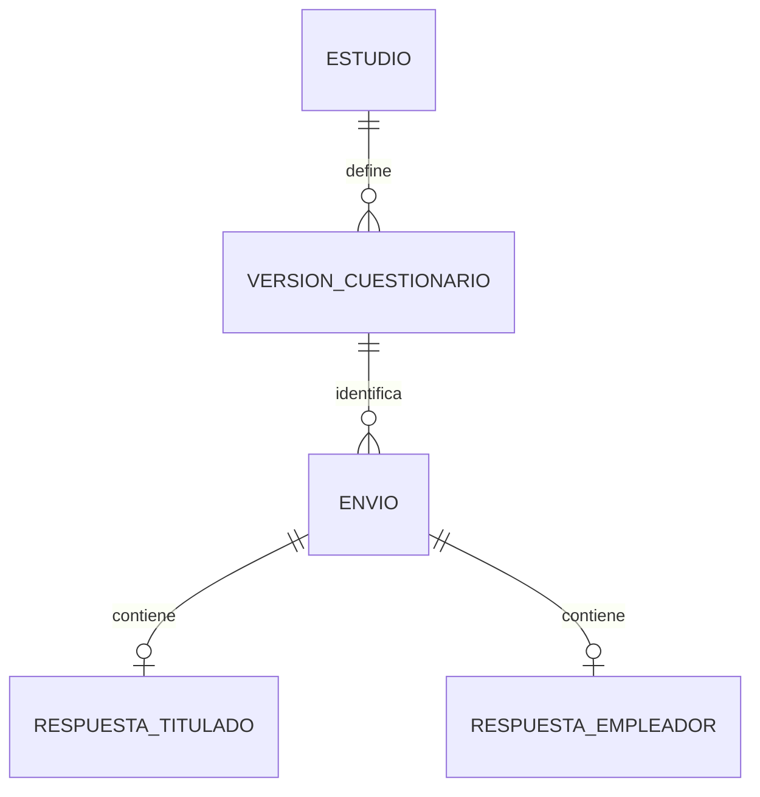

# Paso 03: modelo de datos y Data Wrangling

**Uso:** entregar este archivo a Codex después de `02_REQUISITOS_CUESTIONARIOS.md`. Conservarlo en `docs/03_DATOS_Y_DATA_WRANGLING.md`.

**Estado:** propuesta técnica de diseño. Los IDs, preguntas y decisiones pendientes del paso 02 se conservan. Las elecciones de almacenamiento y procesamiento aquí descritas desarrollan la exigencia de Data Wrangling de la guía; no son tecnologías impuestas por el PDF.

**Resultado de esta etapa:** modelo lógico, diccionario de variables, codificación, reglas de calidad, estructura de las matrices analíticas y trazabilidad del procesamiento. La creación de tablas, migraciones y servicios Java corresponde a una etapa de implementación posterior.

**Integración y autorización actual:** este archivo conserva el diseño recibido como referencia. El usuario autorizó implementar la fase 3; esa solicitud prevalece sobre la instrucción documental del apartado 1. El diseño físico, los códigos efectivos, las adaptaciones aprobadas en fase 2, la cobertura ejecutable y sus pendientes se registran en [DATOS_Y_WRANGLING.md](DATOS_Y_WRANGLING.md), [ACEPTACION_DATOS.md](ACEPTACION_DATOS.md) y [DECISIONES.md](DECISIONES.md). No se conectan servicios externos ni se importan contactos por incorporar este documento.

**Adaptación de origen aprobada por el usuario:** los envíos comienzan como `NO_DECLARADO`. Un administrador puede clasificarlos como `REAL` o `SINTETICO`, con motivo y revisión trazable; no se presume origen real por recibir un formulario público. Los históricos conservan ausencia de información verificable sin inventar origen, captura íntegra o metadata anterior. El modo de preparación `OFICIAL` requiere estudio y versión `APROBADA`; la aplicación no aprueba institucionalmente el instrumento de forma automática.

**Correspondencia con fase 2:** edad entera, catálogo de género, meses enteros, hasta dos asignaturas de poca utilidad, filtro de experiencia y doce ítems de competencias ya se acordaron para el borrador. Las menciones a D01/D02/D05/D06/D09 como pendientes en el diseño original se interpretan según las resoluciones registradas. Los nombres `tNN_`/`eNN_` y códigos abreviados de este archivo son propuestas de diseño; no reemplazan silenciosamente los identificadores y códigos ya conservados por la aplicación. La referencia vigente está en el diccionario de implementación.

## 1. Instrucción para Codex

Revisa los pasos 01 y 02 y las instrucciones del repositorio. Incorpora este documento y sus referencias, preservando archivos y decisiones existentes. Comprueba la correspondencia de cada variable con su pregunta y con la versión del instrumento.

En esta tarea documenta el diseño de datos y el pipeline. No conectes Neon, ejecutes migraciones, cargues contactos, inventes encuestas respondidas ni implementes todavía análisis, reportes o simulación. Los ejemplos de este archivo son sintéticos y las comprobaciones describen el comportamiento esperado para la implementación futura.

La estadística univariada y bivariada, chi-cuadrado, visualización computacional y automatización de reportes de HU5 consumirán los resultados de este pipeline. Mantén sus requisitos registrados y deja el detalle de cálculo para el documento estadístico siguiente.

## 2. Fuentes y decisiones que se conservan

Fuente principal: `JOSE ARMANDO MAREÑO MAMANI - EstudioMercadoHerramientaColeccionDatos.pdf`, **Guía Metodológica y Técnica Integral: Análisis de Mercado y Herramienta de Recolección de Datos (Enfoque ARCUSUR)**, de 20 páginas.

- La página 1 exige Data Wrangling, estadística univariada, bivariada con chi-cuadrado y visualización computacional.
- HU1-HU4, páginas 3 y 4, determinan las variables y su finalidad analítica.
- HU5, página 5, conecta procesamiento, matrices, gráficos, exportación CSV/Excel y automatización en el backend.
- Los anexos de titulados y empleadores están en las páginas 6-13 y 14-20.

El PDF contiene el instrumento, no una muestra de encuestas respondidas. El archivo `candidatos a entrevista.xlsx` organiza posibles contactos; sus filas no se importan como respuestas ni como evidencia de elegibilidad. La copia de edad y género que muestra una sola opción se mantiene como ambigüedad del instrumento.

Se conservan Java, Spring Boot, PostgreSQL y el monolito modular por capas como base prevista. El procesamiento estadístico y la preparación de datos se realizarán en el backend Java; la interfaz consumirá sus resultados.

Los estados **FUENTE**, **PROPUESTA** y **PENDIENTE** del paso 02 mantienen su significado. Los códigos de opciones y nombres de variables de este archivo son la base técnica propuesta para implementar; Codex puede resolver y documentar ajustes técnicos rutinarios. Esos ajustes no cambian las etiquetas ni resuelven por sí solos decisiones sobre el significado del instrumento.

## 3. Modelo lógico propuesto

### 3.1. Separación de responsabilidades

| Componente | Información conservada | Relación principal |
| --- | --- | --- |
| `estudio` | Identificador de campaña, nombre, período y fecha de referencia aprobada. | Un estudio contiene versiones y envíos. |
| `version_cuestionario` | Tipo TITULADOS/EMPLEADORES, versión, estado BORRADOR/APROBADA/RETIRADA, definiciones de preguntas y catálogos, reglas y huella de contenido. | Una versión pertenece a un estudio; los envíos apuntan a la versión usada. |
| `envio` | UUID de respuesta, estudio, versión, fecha UTC de envío, origen REAL/SINTETICO, estado de recepción y datos de control de reintentos. | Cada envío aceptado tiene una respuesta del tipo correspondiente. |
| `respuesta_titulado` | Campos estructurados del cuestionario de titulados, con estados de respuesta y pertenencia a la versión. | Como máximo una por envío; obligatoria si el tipo es TITULADOS. |
| `respuesta_empleador` | Caracterización y valoraciones estructuradas del empleador, con estados y pertenencia a la versión. | Como máximo una por envío; obligatoria si el tipo es EMPLEADORES. |
| `seleccion_multiple` | Pregunta, opción seleccionada y envío. Una fila por opción distinta. | Varias selecciones por respuesta; sin duplicar una opción en la misma pregunta. |
| `contacto_identificacion` | T32-T34, E00/E01 y autorizaciones aplicables; relación con el envío. | Acceso restringido; separado de las consultas analíticas ordinarias. |
| `captura_original` | Valores de preguntas recibidos y aceptados, antes de transformaciones analíticas; metadatos de fuente y huella del contenido. | Una captura original por envío aceptado, conservada sin sobrescrituras. |
| `ejecucion_wrangling` | UUID de ejecución, selección congelada de entradas, versiones de reglas/catálogos/correcciones, fecha de referencia y estado del proceso. | Una ejecución prepara un conjunto analítico identificable. |
| `miembro_conjunto` | Envíos y versiones de captura incluidos o excluidos, con motivo; cada envío figura una sola vez por ejecución. | Vincula una ejecución con sus entradas exactas. |
| `incidencia_calidad` | Variable o grupo afectado, regla, gravedad, motivo y estado de revisión; ejecución y envío relacionados. | Un envío puede tener varias incidencias, con efectos distintos por análisis. |
| `valoracion_competencia` | Ítem aprobado, matriz T39/T40, valor y estado de respuesta. | Extensión pendiente de D05; no crear ítems ni puntajes arbitrarios. |

Los nombres anteriores representan responsabilidades lógicas. El diseño físico posterior podrá simplificar algunos componentes o conservar metadatos en JSONB, siempre que cumpla las restricciones y la trazabilidad. No desarrollar un constructor genérico de encuestas: la metadata describe los dos instrumentos de este proyecto.

Cada envío aceptado contiene exactamente una de las dos respuestas tipadas, de acuerdo con su versión. La captura, contactos y selecciones se vinculan mediante el mismo identificador de envío. Esa exclusión entre tipos debe comprobarse al guardar, no suponerse por el dibujo.

La captura original puede contener contactos, identificación y textos abiertos. Su acceso será restringido como el de esos datos; no se expondrá automáticamente en consultas o exportaciones analíticas ordinarias.

### 3.2. Restricciones de integridad

1. Un envío pertenece a un único estudio y una versión concreta. La versión y sus reglas deben pertenecer al mismo estudio.
2. La versión usada en una recolección real estará aprobada. Conservar las versiones usadas; modificar un instrumento no cambia retroactivamente los envíos anteriores.
3. El valor, estado de respuesta, código de pregunta y opción deben ser coherentes con esa versión. Una pregunta ausente en una versión no se vuelve obligatoria por agregarla después.
4. En una pregunta de selección única, conservar un solo código válido. En selección múltiple, la clave lógica `(envio_id, pregunta_id, opcion_codigo)` será única.
5. Guardar envío, respuesta tipada, selecciones, contactos y captura original como una operación coherente. Una respuesta final no debe quedar anunciada como completa si falla una parte del guardado.
6. Usar una clave de reintento acotada al estudio y al tipo de cuestionario. La misma clave y el mismo contenido devuelven el mismo envío; la misma clave con contenido diferente genera un conflicto, sin sobrescribir la respuesta previa.
7. El correo y nombre de organización no son claves universales de persona o institución. No imponer unicidad global para decidir duplicados.
8. Las correcciones posteriores conservan el original y una descripción versionada de lo corregido, motivo y autorización correspondiente. Una ejecución identifica exactamente qué correcciones aplica.
9. Las restricciones entre componentes deben resolverse con transacciones, validación y mecanismos de base de datos adecuados al esquema físico. Un control de pantalla no garantiza la integridad persistida.

### 3.3. Representación técnica prevista

| Dato lógico | PostgreSQL previsto | Representación Java prevista | Regla |
| --- | --- | --- | --- |
| Identificador de envío/ejecución | UUID | UUID | Estable, sin usar contactos como ID. |
| Código de opción/pregunta | VARCHAR/TEXT y catálogo versionado | String o tipo de dominio | No reinterpretar códigos mediante posición de una lista. |
| Sí/No | BOOLEAN nullable | Boolean | `false` representa No; `null` necesita un estado de respuesta. Evitar que un valor ausente se convierta en falso por defecto. |
| Año de egreso | INTEGER nullable | Integer | Año entero; fecha de referencia y rango inferior por definir. |
| Duración profesional/desempleo | NUMERIC nullable | BigDecimal | Precisión y unidad aprobadas; sin redondeo silencioso. |
| Texto | TEXT/VARCHAR | String | Original protegido y versión normalizada separada cuando proceda. |
| Fecha de recepción | TIMESTAMP WITH TIME ZONE | Instant | Persistencia con instante UTC; presentación local según necesidad. |
| Captura y metadata estructurada | JSONB u otra representación que preserve valores | Objeto/serialización definida | Usar valores originales de preguntas; conservar los textos numéricos antes de convertirlos. |

Definir límites de longitud y precisión antes de implementar entradas. PostgreSQL, DTO y validación deberán aplicar límites compatibles. La copia estructurada de captura conserva los valores del instrumento; si se necesita preservar bytes de un archivo importado, conservar también el archivo fuente y su huella. La representación estructurada no sustituye ese original.

## 4. Diccionario de variables

### 4.1. Convenciones y clasificación

Los prefijos `tNN_` y `eNN_` conservan el ID del paso 02. Cada variable tendrá además etiqueta, fuente/página, tipo, catálogo, unidad, obligatoriedad, condición de aplicabilidad, clasificación de acceso y versión. El estado se expresa como `<variable>__estado`; las incidencias se registran por separado.

- **Nominal:** categorías sin orden numérico de medición.
- **Ordinal:** categorías ordenables; su código no es una cantidad ni garantiza distancias iguales.
- **Numérica:** número con unidad o definición explícita.
- **Múltiple:** conjunto de códigos, conservado en una relación de selecciones.
- **Texto:** contenido abierto, con posible codificación temática posterior.
- **Privada:** contacto o identificación excluidos de la matriz analítica ordinaria.
- **Pendiente:** estructura o dominio dependientes de D01-D15 del paso 02.

Las matrices analíticas ordinarias incluirán variables estructuradas autorizadas. Los textos abiertos se conservarán bajo acceso restringido y podrán producir categorías revisadas; contactos, nombres y texto original no se incorporan automáticamente a la salida ordinaria.

### 4.2. Titulados: campos del anexo

| ID | Variable propuesta | Tipo / tratamiento |
| --- | --- | --- |
| T01 | `t01_edad_grupo` | Categoría pendiente de D01; no inferir edad exacta desde «35 años o más». |
| T02 | `t02_genero` | Nominal; catálogo pendiente de D01. |
| T03 | `t03_formacion_complementaria` | Boolean nullable. |
| T04 | `t04_nivel_complementario` | Categoría ordinal NIVEL_REALIZADO; combina concluido/en curso según el anexo. |
| T05 | `t05_institucion_realizada` | Nominal INSTITUCION. |
| T06 | `t06_financiamiento_realizado` | Nominal FINANCIAMIENTO_REALIZADO. |
| T07 | `t07_nombre_programa` | Texto restringido; codificación temática propuesta. |
| T08 | `t08_interes_posgrado` | Boolean nullable. |
| T09 | `t09_area_posgrado` | Nominal AREA_INTERES. |
| T10 | `t10_institucion_preferida` | Nominal INSTITUCION. |
| T11 | `t11_afinidad_posgrado_fcyt` | Ordinal ACUERDO_4. |
| T12 | `t12_vida_profesional` | Numérica; unidad y precisión pendientes de D02. |
| T13 | `t13_tiempo_desempleado` | Numérica; unidad compatible con T12, pendiente de D02. |
| T14 | `t14_situacion_laboral` | Nominal SITUACION_LABORAL. |
| T15 | `t15_origen_emprendimiento` | Nominal ORIGEN_EMPRENDIMIENTO. |
| T16 | `t16_entregable_negocio` | Nominal ENTREGABLE_NEGOCIO. |
| T17 | `t17_financiamiento_negocio` | Nominal FINANCIAMIENTO_NEGOCIO. |
| T18 | `t18_satisfaccion_negocio` | Ordinal SATISFACCION_3. |
| T19 | `t19_importancia_formacion_negocio` | Ordinal IMPORTANCIA_4. |
| T20 | `t20_primer_empleo_actual` | Boolean nullable; aplicabilidad pendiente de D09. |
| T21 | `t21_tiempo_primer_empleo` | Categoría temporal; intervalos pendientes de D10. «Antes de titularse» conserva su categoría propia. |
| T22 | `t22_cantidad_empleos_categoria` | Ordinal; 1, 2, 3, MÁS_DE_3. No tratar la categoría abierta como un conteo exacto. |
| T23 | `t23_satisfaccion_formacion` | Ordinal ACUERDO_4; conservar la diferencia entre enunciado y escala. |
| T24 | `t24_concordancia_formacion_puesto` | Ordinal ACUERDO_4; redacción y aplicabilidad pendientes. |
| T25 | `t25_aspectos_utiles` | Múltiple ASPECTOS_UTILES. |
| T26 | `t26_aspectos_mejorables` | Múltiple ASPECTOS_MEJORABLES. |
| T27 | `t27_asignaturas_utiles` | Múltiple ASIGNATURAS_UTILES; conteo de «otra» pendiente de D06. |
| T28 | `t28_otra_asignatura_util` | Texto restringido; no integrar automáticamente en el conteo de T27. |
| T29 | `t29_asignaturas_poco_utiles` | Múltiple ASIGNATURAS_POCO_UTILES; cantidad pendiente de D06. |
| T30 | `t30_otra_asignatura_poco_util` | Texto restringido; relación con T29 pendiente. |
| T31 | `t31_interes_red_contactos` | Boolean nullable; distinto de una autorización específica de contacto. |
| T32 | `t32_email_contacto` | Privada; texto validado, conservado en `contacto_identificacion`. |
| T33 | `t33_telefono_contacto` | Privada; texto, conserva prefijo y ceros significativos. |
| T34 | `t34_linkedin_contacto` | Privada; URL como texto validado. |

### 4.3. Titulados: variables de historias y propuestas

| ID | Variable propuesta | Tipo / tratamiento |
| --- | --- | --- |
| T35 | `t35_anio_egreso` | Integer nullable; exigido por HU1, definición pendiente de D02. |
| T36 | `t36_sector_desempeno` | Nominal; catálogo y condición pendientes de D03. |
| T37 | `t37_nivel_posgrado_deseado` | Categoría principal o múltiple; dominio pendiente de D04. |
| T38 | `t38_financiamiento_futuro` | Categoría principal o estructura ponderada; pendiente de D04. Mantener separado de T06. |
| T39 | `t39_competencias_tecnicas` | Matriz pendiente de D05; un registro por ítem aprobado, con estado y escala. |
| T40 | `t40_competencias_transversales` | Matriz pendiente de D05; misma exigencia de definición por ítem. |
| T41 | `t41_experiencia_laboral_filtro` | Dominio pendiente de D09; no convertir en boolean hasta aprobar qué situaciones distingue. |

Los IDs reservados no implican que esas preguntas existan en todas las versiones. Los ítems de una matriz aprobada usarán un código estable como `T39.<codigo_item>`, sin inventar ahora su lista. T37/T38 se convertirán en campos escalares solo si se elige una respuesta principal; la elección múltiple o ponderada requiere ajustar su contrato y relación de almacenamiento.

### 4.4. Empleadores

| ID | Variable propuesta | Tipo / tratamiento |
| --- | --- | --- |
| E00 | `e00_email_participante` | Privada; contacto obligatorio en la fuente, uso sujeto a D12. |
| E01 | `e01_nombre_organizacion` | Identificación restringida; no se usa como identificador universal ni se exporta ordinariamente. |
| E02 | `e02_tipo_organizacion` | Nominal TIPO_ORGANIZACION. |
| E03 | `e03_tamano_organizacion` | Ordinal TAMANO_ORGANIZACION; no asignar cantidad exacta de funcionarios. |
| E04 | `e04_sector_organizacion` | Nominal SECTOR_ORGANIZACION. |
| E05 | `e05_contrato_ultimos_cinco_anios` | Boolean nullable; período referenciado en la versión del estudio. |
| E06 | `e06_expectativa_contratacion` | Categoría CONTRATACION_FUTURA; no equivale a número de plazas o probabilidad numérica. |
| E07 | `e07_nivel_formacion_demandado` | Ordinal o múltiple; cardinalidad pendiente de D08. |
| E08 | `e08_medios_convocatoria` | Nominal o múltiple; cardinalidad y obligatoriedad pendientes de D08. |
| E09 | `e09_cargos` | Múltiple CARGOS. |
| E09_OTRO | `e09_otro_cargo_texto` | Texto restringido complementario, con condición aprobada. |
| E10 | `e10_tendencias_formacion_texto` | Texto restringido; fuente para codificación temática. |
| E11 | `e11_herramientas_requeridas_texto` | Texto restringido; fuente para codificación temática. |
| E12 | `e12_competencias_requeridas_texto` | Texto restringido; no equivale a valoración numérica de competencias. |
| E13 | `e13_confianza_carrera` | Escala EMPLEADORES. |
| E14 | `e14_consistencia_titulo` | Escala EMPLEADORES. |
| E15 | `e15_consulta_regular_empleadores` | Escala EMPLEADORES. |
| E16 | `e16_conocimiento_perfil` | Escala EMPLEADORES. |
| E17 | `e17_coherencia_perfil_desempeno` | Escala EMPLEADORES. |
| E18 | `e18_desempeno_formacion_integral` | Escala EMPLEADORES. |
| E19 | `e19_necesidades_en_formacion_practica` | Escala EMPLEADORES. |
| E20 | `e20_competencias_laborales` | Escala EMPLEADORES. |
| E21 | `e21_valores_actitudes` | Escala EMPLEADORES. |
| E22 | `e22_participacion_retroalimentacion` | Escala EMPLEADORES. |

Los E13-E22 conservan la regla pendiente D07 sobre la repetición del anexo. Si se importa una versión con ambas apariciones, conservar las dos respuestas originales y su posición de origen hasta aplicar una regla aprobada de correspondencia.

## 5. Códigos de catálogos y escalas

### 5.1. Catálogos principales

La etiqueta de pantalla se conserva conforme al paso 02. Los códigos de esta tabla son propuestas estables en ASCII, con significado explícito. Los catálogos se acotan por variable y versión: compartir un código no vuelve intercambiables dos preguntas.

| Catálogo | Código = significado |
| --- | --- |
| Sí/No | `true` = Sí; `false` = No. Los estados de ausencia se expresan por separado. |
| NIVEL_REALIZADO | `DIPLOMADO`; `ESPECIALIDAD`; `MAESTRIA`; `DOCTORADO`; `POSDOCTORADO`. |
| NIVEL_CONTRATACION | `LICENCIATURA` y los cinco niveles anteriores, según E07. Su cardinalidad sigue pendiente. |
| INSTITUCION | `EUPG`; `POSGRADO_FCYT`; `IBNORCA`; `UNIV_INTERNACIONAL`; `UNIV_PUBLICA_NACIONAL`; `UNIV_PRIVADA_NACIONAL`; `OTRO`. |
| FINANCIAMIENTO_REALIZADO | `PROPIO`; `BECA_TOTAL`; `BECA_PARCIAL`. |
| AREA_INTERES | `IA`; `ROBOTICA`; `ING_SOFTWARE`; `BASE_DATOS`; `REDES_SEGURIDAD`. |
| SITUACION_LABORAL | `TRABAJA_ORGANIZACION`; `NO_TRABAJA`; `EMPRENDIMIENTO_TIEMPO_COMPLETO`. |
| ORIGEN_EMPRENDIMIENTO | `IDEA_PROPIA`; `IDEA_COMPARTIDA`; `STARTUP`; `SPINOFF_UNIVERSITARIO`; `OTRO`. |
| ENTREGABLE_NEGOCIO | `PRODUCTO`; `SERVICIO`; `AMBOS`. |
| FINANCIAMIENTO_NEGOCIO | `PRESTAMO_BANCARIO`; `INVERSORES`; `PROPIO`. |
| TIEMPO_PRIMER_EMPLEO | `ANTES_TITULACION`; `MENOS_1_MES`; `ENTRE_1_4_MESES`; `ENTRE_4_8_MESES`; `ENTRE_8_12_MESES`; `MAS_12_MESES`. Los límites se aprueban aparte. |
| CANTIDAD_EMPLEOS | `UNO`; `DOS`; `TRES`; `MAS_TRES`. Cero no se incorpora sin resolver D10. |
| TIPO_ORGANIZACION | `PUBLICO`; `PRIVADO`. |
| TAMANO_ORGANIZACION | `MICRO`; `PEQUENA`; `MEDIANA`; `GRANDE`. Rangos de funcionarios conforme al anexo. |
| CONTRATACION_FUTURA | `ALTA_POSIBILIDAD`; `SEGUN_CRECIMIENTO`; `NO_PREVISTA`; `NO_REQUIERE`. La fuente usa alta probabilidad como etiqueta cualitativa; no asignar un porcentaje. |
| SECTOR_ORGANIZACION | `DESARROLLO_SOFTWARE`; `SERVICIOS_TI`; `TELECOM_REDES`; `SOPORTE_MANTENIMIENTO`; `CONSULTORIA_TRANSFORMACION`; `BANCA_FINANZAS`; `PUBLICO_GOBIERNO`; `EDUCACION_INVESTIGACION`; `INDUSTRIA_MANUFACTURA`; `COMERCIO_ECOMMERCE`; `SALUD`; `CIBERSEGURIDAD`; `DATOS_BI`; `STARTUP_TECNOLOGICA`; `OTROS`. |

Los catálogos de T01/T02/T36/T37/T38/T41 y los ítems T39/T40 conservan sus pendientes. Los ejemplos de HU2 y HU3 no se agregan silenciosamente a catálogos de otras preguntas. El financiamiento futuro ponderado, si se elige, necesita pesos y regla de suma explícitos antes de calcular contingencias.

### 5.2. Catálogos de preguntas múltiples

| Catálogo | Códigos, en el orden de opciones del paso 02 |
| --- | --- |
| ASPECTOS_UTILES | `PRACTICA_PROYECTOS`; `PASANTIAS`; `HORARIOS`; `ANALISIS_PROBLEMAS`; `EQUIPOS_MULTIDISCIPLINARIOS`; `HERRAMIENTAS_INDUSTRIA`. |
| ASPECTOS_MEJORABLES | `TEORIA_PRACTICA`; `VINCULO_EMPRESAS`; `HORARIOS_MODALIDADES`; `ACTUALIZACION_PLAN`; `ACTIVIDADES_EXTRACURRICULARES`; `MAS_ESPECIALIZACIONES`. |
| ASIGNATURAS_UTILES | `INTRODUCCION`; `BASE_DATOS`; `IA`; `REDES_COMPUTADORA`; `ELECTIVAS`; `TIS`; `BASICAS`; `PLANIFICACION_GESTION`; `REDES_AVANZADAS`. |
| ASIGNATURAS_POCO_UTILES | `BASICAS`; `TV_DIGITAL`; `TELEFONIA_IP`; `WEB_SEMANTICAS`; `GRAFICACION`; `ROBOTICA`; `PROGRAMACION_BAJO_NIVEL`; `AUTOMATAS_LENGUAJES`; `PROGRAMACION_FUNCIONAL`; `GRAFOS`; `CONTABILIDAD_BASICA`. |
| CARGOS | `APOYO`; `TECNICO`; `ANALISTA`; `ESPECIALISTA`; `SUPERVISION`; `JEFATURA_GERENCIA`; `CONSULTORIA`; `OTRO`. |
| MEDIOS_CONVOCATORIA | `ESCRITOS_AUDIOVISUALES`; `INTERNET_REDES`; `CONVOCATORIA_COMPETITIVA`; `OFERTA_PERSONAL`; `RECOMENDACION`; `OTROS`. Su selección única o múltiple está pendiente. |

Las categorías «Otra asignatura» de texto mantienen IDs T28/T30 separados. Estos códigos no crean una opción adicional en T27/T29 ni deciden cómo contabilizarla.

### 5.3. Escalas: código, orden y puntaje

| Escala | Códigos de las etiquetas | Orden/puntaje |
| --- | --- | --- |
| ACUERDO_4 | `TDES` = totalmente en desacuerdo; `DES` = en desacuerdo; `AC` = de acuerdo; `TAC` = totalmente de acuerdo. | Orden de menor a mayor acuerdo. Un eventual puntaje 1-4 requiere el protocolo estadístico; no convertir en 1-5. |
| SATISFACCION_3 | `INSAT`; `ALGO_SAT`; `SAT`. | Orden de menor a mayor satisfacción; no homologar automáticamente con otras escalas. |
| IMPORTANCIA_4 | `NO_IMPORTA`; `POCO_IMPORTA`; `IMPORTA`; `MUY_IMPORTA`. | Orden de menor a mayor importancia. |
| EMPLEADORES | `TAC`; `PAC` = parcialmente de acuerdo; `TDES`; `NS` = No sabe. | Para acuerdo: TDES < PAC < TAC. NS conserva respuesta válida, sin rango/puntaje de acuerdo. Mantener el orden de pantalla del original. |
| COMPETENCIAS_HU4 | Pendiente de D05. | La sugerencia 1-5 no fija ítems, anclajes ni fórmula de brecha. |

Guardar código y versión de escala como información primaria. Un número de orden permite ordenar, pero no demuestra que las distancias entre categorías sean iguales. El documento estadístico definirá cuándo presentar frecuencias, medianas o resúmenes numéricos y cómo tratar «No sabe».

## 6. Estados de respuesta y calidad

### 6.1. Captura y preparación analítica

| Estado | Uso |
| --- | --- |
| `CON_VALOR` | La pregunta aplicable tiene un valor. Incluye un No válido, cero válido o «No sabe» cuando están admitidos. |
| `SIN_RESPUESTA` | Pregunta presente y aplicable que quedó sin respuesta. La obligatoriedad determina si puede aceptarse un envío final. |
| `NO_APLICA` | Pregunta excluida por una condición aprobada. |
| `NO_RECOLECTADA` | Estado adicional de la matriz analítica: la variable no existía en la versión del instrumento. No es un salto ni incumplimiento de obligatoriedad. |
| `VALOR_INVALIDO` | Estado adicional de preparación: entrada importada o detectada como incompatible con el dominio; conservar el original y registrar incidencia. |

Los tres primeros estados conservan el contrato del paso 02. Los dos adicionales describen comparabilidad y calidad analítica; no agregan opciones al formulario. Las incidencias relacionales pueden afectar varias variables sin permitir identificar cuál de ellas fue contestada incorrectamente.

En las salidas estructuradas, un valor ausente se representa con `NULL` y un estado explícito. «No sabe» mantiene el código `NS` con estado `CON_VALOR`; solo su eventual puntaje es `NULL`.

### 6.2. Incidencias y alcance de exclusión

| Gravedad/estado de calidad | Efecto propuesto |
| --- | --- |
| `ERROR_DOMINIO` | Valor fuera de catálogo, número ilegible, rango inválido u otra entrada incompatible. Bloquear la variable o cálculo afectado y conservar evidencia. |
| `ERROR_RELACION` | Inconsistencia entre variables, por ejemplo desempleo mayor que vida profesional con unidades compatibles. Revisar el grupo afectado; no adivinar el dato correcto. |
| `ADVERTENCIA` | Situación revisable que no demuestra invalidez, como un valor extremo permitido. Conservar el valor y documentar tratamiento. |
| `PENDIENTE_REGLA` | La definición del instrumento todavía no permite transformar o comparar un campo. Continuar con los campos independientes. |

Una incidencia en una pregunta no excluye automáticamente toda la respuesta de cualquier estadística. Cada análisis aplicará criterios documentados para sus variables. La invalidez de un envío completo o la exclusión de una participación requiere un motivo registrado.

## 7. Pipeline de Data Wrangling

La entrada inicial son respuestas recolectadas por la aplicación. Las reglas que mencionan importaciones anticipan posibles fuentes de respuestas externas; no ordenan desarrollar ahora un importador ni cargar archivos de candidatos como encuestas.

### DW01. Seleccionar y congelar entradas

Crear una ejecución con estudio, tipos de cuestionario, versiones admitidas, corte temporal y filtros. Registrar los IDs exactos y huellas de las capturas utilizadas, origen REAL/SINTETICO y correcciones aprobadas. Un corte temporal sin inventario de miembros no basta si posteriormente cambian las entradas.

Los análisis reales usan solo datos reales elegibles. Los ejemplos y pruebas utilizan datos sintéticos identificados. Registrar el criterio de elegibilidad; no deducirlo únicamente del directorio de candidatos ni de E05.

### DW02. Comprobar estructura y correspondencia

Validar ID de envío, tipo, versión, existencia de campos y catálogos, unidades y estados. Cada pregunta se interpreta con la definición vigente cuando se respondió. Si una variable no existía, producir `NO_RECOLECTADA` y evitar exigirla retroactivamente.

Una variable presente sin definición suficiente genera `PENDIENTE_REGLA`. Las reglas sin resolver no se convierten en valores asumidos.

### DW03. Normalizar formatos conservando originales

Proponer transformaciones acotadas: quitar espacios exteriores en valores de control, unificar variantes de Sí/No mediante una lista explícita y mapear etiquetas a códigos del catálogo correspondiente.

Conservar textos abiertos originales. Las formas normalizadas para búsqueda o codificación se guardan aparte; preservar acentos, nombres, siglas y contenido significativo en la fuente. Un valor desconocido no se convierte automáticamente en «Otro».

Cada mapeo debe identificar variable, versión de entrada, valor original y código de salida. La coincidencia aproximada entre nombres o tecnologías requiere una regla revisada.

### DW04. Convertir tipos y unidades

Convertir años enteros y duraciones con reglas de formato explícitas. El separador decimal depende del contrato de entrada/importación; si `1.234` puede representar un decimal o miles, no adivinar su interpretación.

Las conversiones de unidad se aplican solo cuando la unidad de entrada y la unidad canónica estén aprobadas. Registrar ambas y la fórmula. No redondear antes de validar ni convertir dos veces la misma unidad en ejecuciones sucesivas. El pipeline parte de las capturas originales.

### DW05. Resolver aplicabilidad y faltantes

Aplicar la matriz condicional aprobada del paso 02. Evaluar formación realizada, interés futuro, situación laboral, experiencia y contactos conforme a esa versión.

Conservar la diferencia entre No, cero, «No sabe», vacío, salto y variable ausente de versión. No imputar por defecto media, moda, respuesta negativa o categoría neutra. Las futuras imputaciones, si se justifican, deberán producir un resultado separado con su método y alcance.

### DW06. Preparar selecciones múltiples

Construir una tabla larga con una fila por `(envio_id, pregunta_id, opcion_codigo)` distinta. Conservar el estado de la pregunta aunque no existan filas de selección. Las repeticiones de una opción en una importación generan una incidencia y una regla documentada de consolidación.

Para una matriz ancha, crear indicadores por opción:

- `1`: la opción fue seleccionada en una respuesta válida de esa pregunta.
- `0`: la pregunta tiene una respuesta válida y esa opción no fue seleccionada.
- `NULL`: la pregunta está sin respuesta, no aplica, no se recolectó o no tiene información válida para esa codificación; conservar el estado.

Una lista vacía no demuestra «ninguna opción»: el instrumento debe definir si existe esa respuesta. No sumar selecciones como si cada una fuera un nuevo encuestado. El conteo de cinco/dos asignaturas y la relación con campos de texto siguen D06.

### DW07. Revisar duplicados de participación y criterios

Distinguir reintentos técnicos de respuestas distintas. Los reintentos del mismo envío no aumentan la muestra. Respuestas con correo, organización o contenido parecido se marcan como posibles duplicados; no se eliminan automáticamente sin la política D13 y la unidad de análisis definida.

Para E13-E22, si una versión importada contiene ambas apariciones del anexo, conservar los valores originales y su posición. Con D07 resuelta, valores coincidentes pueden consolidarse según el mapeo aprobado. Valores diferentes generan una incidencia de conflicto y requieren resolución; no escoger el primero, el mayor ni una media silenciosa.

Toda exclusión o consolidación identifica entradas afectadas, motivo y regla. Los informes posteriores muestran cuántos envíos o campos se excluyeron y por qué.

### DW08. Codificar textos abiertos

Aplicar un libro de códigos versionado a T07/T28/T30/E09_OTRO/E10/E11/E12 cuando se acuerde analizar su contenido. Definir etiquetas temáticas, significado, criterios de asignación y si se permiten varias por respuesta. Conservar el vínculo al texto original y la revisión realizada.

La primera propuesta es codificación revisada con reglas explícitas, sin introducir un servicio de IA o clasificador por defecto. Las menciones repetidas del mismo tema en un texto no multiplican el número de participantes que lo mencionan.

T39/T40 requieren ítems y escalas definidos, no una conversión automática de E12 a puntuaciones de competencia. El acceso al texto original se mantiene restringido; la matriz ordinaria puede incorporar categorías revisadas.

### DW09. Generar variables derivadas

Cada derivación declara sus entradas, fórmula, unidad, fecha de referencia, versión y estados válidos necesarios. Si falta una entrada o su regla, la salida queda sin valor y con motivo.

| Variable derivada propuesta | Regla y límite |
| --- | --- |
| `antiguedad_egreso_anios_calendario` | Año de referencia del estudio menos T35, una vez resuelta D02. Es diferencia de años calendario, no tiempo exacto desde una fecha completa. No sustituye automáticamente a T12. |
| `vida_profesional_unidad_canonica` | Conversión de T12 desde la unidad aprobada a la unidad canónica documentada. Mantener T12 original. |
| `desempleo_unidad_canonica` | Conversión de T13 con el mismo contrato temporal. Validar la relación con la vida profesional considerada. |
| Indicadores por opción múltiple | Según DW06, con 1/0/NULL y estado de la pregunta. |
| Categorías temáticas | Según libro de códigos y revisión de DW08; no equivalen a respuestas originales del catálogo. |

No derivar edad exacta desde un grupo, número de empleados desde el tamaño organizacional, cuatro empleos desde «Más de 3», plazas desde expectativa de contratación ni puntajes desde «No sabe». La segmentación junior/consolidado y la medición de brechas requerirán umbrales y protocolo aprobados.

### DW10. Definir elegibilidad por resultado

Preparar información que permita identificar respuestas válidas por variable y pares válidos para cada cruce. El cruce HU3 de financiamiento futuro × nivel deseado usa T38/T37 comparables; el pasado usa T06/T04 y tendrá un nombre distinto.

No mezclar formularios de titulados y empleadores en un denominador común ni unir personas con empresas suponiendo una relación que no se capturó. La comparación por sectores u otras categorías exige correspondencias explícitas.

El documento estadístico definirá denominadores y condiciones de chi-cuadrado. El pipeline proporciona conteos y estados necesarios; no declara independencia de observaciones solo porque cada fila tenga un ID diferente.

### DW11. Construir matrices y verificar cardinalidad

Generar las salidas de la sección 8. La matriz ancha contiene una fila por envío elegible en ese conjunto; las relaciones de selecciones y categorías temáticas pueden contener varias filas por envío.

Evitar que unir dos relaciones de selección múltiple produzca combinaciones de opciones que inflen la muestra. Proyectar indicadores o preparar agregados por envío antes de combinar conjuntos. Contrastar filas e IDs distintos con el inventario de miembros.

### DW12. Publicar un conjunto reproducible

Conservar el manifiesto, diccionario, incidencias, exclusiones y huella del contenido analítico. Ordenar filas y columnas mediante reglas estables antes de calcular la huella.

Repetir las mismas capturas, correcciones, versiones, filtros y fecha de referencia debe generar los mismos valores analíticos. El ID de ejecución o el instante técnico de procesamiento pueden cambiar; no forman parte de la comparación de contenido lógico.

Una ejecución se marca completa solo cuando sus salidas son coherentes. Un fallo no sustituye un conjunto anterior válido por una salida parcial. HU5 identificará el conjunto usado para producir cada reporte automatizado.

## 8. Contrato de salidas para análisis y reportes

Los nombres siguientes representan vistas o productos lógicos. No se crean archivos CSV/Excel ni se elige todavía la estrategia de materialización física.

| Salida | Unidad de fila | Contenido |
| --- | --- | --- |
| `matriz_titulados` | Un envío elegible de titulados | ID interno, versión, variables estructuradas autorizadas, estados e indicadores derivados. Sin contactos ni texto original por defecto. |
| `matriz_empleadores` | Un envío elegible de empleadores | ID interno, versión, caracterización y diez criterios cuando el mapeo esté aprobado; sin nombre/correo por defecto. |
| `selecciones_largas` | Una opción por pregunta y envío | ID interno, pregunta, opción, versión y vínculo a ejecución. |
| `codificacion_textos` | Un tema revisado por pregunta/envío | Código temático, libro de códigos, revisión y vínculo al texto restringido. |
| `resumen_calidad` | Regla/variable/grupo de estado | Cantidades de faltantes, no aplicables, no recolectadas, inválidas y excluidas, con ámbito claro. |
| `diccionario_conjunto` | Una variable o indicador | Nombre, pregunta, etiqueta, tipo, unidad, catálogo/escala, versiones comparables, transformación y clasificación de acceso. |
| `manifiesto_conjunto` | Un conjunto procesado | Identidad, entradas, versiones, corte, filtros, referencia temporal, correcciones, conteos y huella lógica. |

En JSON, conservar `null` real. En una futura salida tabular, las celdas vacías irán acompañadas del estado o de una tabla de estados claramente vinculada; no usar 0, -1, -99 o 999 como sustitutos numéricos de ausencia. La especificación de exportación definirá representación, codificación y formatos.

Los IDs internos permiten trazabilidad bajo permisos; excluir identificadores directos no convierte automáticamente una matriz individual en anónima. El acceso y las salidas autorizadas se resolverán conforme a D12, manteniendo la declaración de confidencialidad de la guía.

## 9. Ejemplos sintéticos de transformación

Estos ejemplos explican las reglas; no son respuestas extraídas del PDF ni del Excel, y no aprueban las decisiones D01-D15.

| Entrada ilustrativa | Salida/efecto esperado |
| --- | --- |
| T03 = No; T04 vacío, con salto aprobado | T03 = false/CON_VALOR; T04 = NULL/NO_APLICA. |
| E13 = «No sabe» | Código NS/CON_VALOR; puntaje de acuerdo NULL. |
| T25 responde PRACTICA_PROYECTOS y PASANTIAS | Dos filas de selección; ambos indicadores 1 y las demás opciones 0 para esa pregunta respondida válidamente. |
| T25 sin respuesta | Ninguna fila de selección, estado SIN_RESPUESTA y todos sus indicadores NULL. |
| Una versión antigua no contiene T38 | T38 = NULL/NO_RECOLECTADA; no se inventa financiamiento futuro desde T06. |
| T22 = «Más de 3» | Código MAS_TRES; conservar categoría, sin conteo exacto supuesto. |
| E03 = «Grande, 100 o más» | Código GRANDE; cantidad exacta de funcionarios desconocida. |
| T12 = 2 y T13 = 3, suponiendo unidades compatibles aprobadas | Incidencia ERROR_RELACION; conservar ambos originales y bloquear resultados afectados conforme a regla, sin adivinar cuál fue incorrecto. |
| T35 = 2020 y año de referencia = 2026, con D02 resuelta para este ejemplo | Antigüedad calendario = 6; T12 conserva su dato independiente. |
| Dos respuestas diferentes al mismo criterio duplicado del anexo | Conservar ambas; generar incidencia de conflicto y revisión del mapeo, sin promedio automático. |

## 10. Trazabilidad y decisiones de datos pendientes

### 10.1. Manifiesto mínimo de ejecución

- `ejecucion_id`, estudio, fecha de referencia y origen de los datos.
- Tipo/versión de cada cuestionario y huella de su definición.
- IDs y huellas exactas de capturas; inventario de inclusiones/exclusiones y motivos.
- Versión de reglas, catálogos, normalizaciones, libro de códigos y correcciones aplicadas.
- Corte temporal, filtros y criterios de elegibilidad.
- Recuentos de entrada y salida por tipo de cuestionario, sin confundir filas de opciones con envíos.
- Incidencias por regla y estado de revisión.
- Orden de variables, formato canónico y huella lógica del conjunto resultante.
- Estado de ejecución y momento técnico de procesamiento.

### 10.2. Pendientes adicionales de esta etapa

Los D01-D15 del paso 02 siguen abiertos mientras no exista una resolución. Los siguientes IDs se añaden al registro, sin renumerar los anteriores:

| ID | Decisión pendiente | Consecuencia |
| --- | --- | --- |
| D16 | Unidad de análisis de empleadores: participante, organización u otra definida; tratamiento de varios representantes de la misma organización. | Deducción de duplicados, agregación e independencia en cruces. No equiparar automáticamente un envío con una empresa distinta. |
| D17 | Unidades canónicas y precisión de duraciones, límites de textos, rangos y contrato de formatos de importación. | Validación y tipos físicos compatibles. |
| D18 | Libro de códigos de textos, categorías temáticas y proceso de revisión. | Comparabilidad de respuestas abiertas y preparación de indicadores. |
| D19 | Correspondencia semántica entre versiones y procedimiento de corrección/consolidación. Las convenciones técnicas de códigos se documentan sin requerir una decisión institucional para cada nombre. | Reproducibilidad y mantenimiento del diccionario. |
| D20 | Estrategia física para los estados, capturas y conjuntos analíticos: vistas, tablas o generación por ejecución. | Migraciones, consultas y coste de almacenamiento; resolver al implementar con el alcance real. |

La falta de una estrategia física definitiva no impide cerrar el contrato lógico. La falta de una definición semántica sí impide afirmar que un indicador concreto está listo para usarse.

## 11. Criterios de aceptación del modelo y pipeline

Estos casos describen comprobaciones futuras; entregar el Markdown no significa haber implementado o ejecutado el pipeline.

| Caso | Situación | Evidencia esperada |
| --- | --- | --- |
| CDA01 | Una respuesta válida se guarda. | Envío, tipo, versión, selecciones, contactos y captura original son coherentes; existe exactamente una respuesta tipada. |
| CDA02 | Falta un Boolean opcional o una pregunta es no aplicable. | El valor permanece NULL con su estado; no se convierte en false. |
| CDA03 | Se procesa una versión sin T35 o T38. | Las variables ausentes quedan NO_RECOLECTADA; no se imputan con T12 o T06. |
| CDA04 | Se selecciona No sabe en E13-E22. | Código NS y estado CON_VALOR; no tiene puntaje de acuerdo. |
| CDA05 | Se procesa una pregunta múltiple válida. | Cada opción aparece una vez; el conjunto conserva una sola fila principal por envío. |
| CDA06 | Se combinan dos preguntas múltiples. | El número de encuestados no se multiplica por las combinaciones de opciones. |
| CDA07 | Una pregunta múltiple queda sin respuesta. | Sus indicadores son NULL y el estado se conserva; no se interpreta como rechazo de todas las opciones. |
| CDA08 | Se detecta un número ambiguo o una etiqueta desconocida. | Se conserva original y se registra incidencia; no se adivina un número ni se asigna Otro por defecto. |
| CDA09 | Se detecta una relación temporal imposible con unidades aprobadas. | Se registra el grupo afectado y el motivo; los resultados dependientes no usan valores corregidos sin fundamento. |
| CDA10 | Se repite el mismo envío técnico. | No aumenta el inventario de respuestas; un mismo identificador de reintento con otro contenido genera conflicto. |
| CDA11 | Dos envíos tienen el mismo correo o nombre organizacional. | Se aplica el criterio de participación y unidad de análisis; no se elimina una respuesta solo por la coincidencia. |
| CDA12 | Se consolidan los criterios duplicados de empleadores. | El resultado conserva diez criterios según D07; un conflicto de valores queda revisable y no se promedia automáticamente. |
| CDA13 | Se codifica un texto abierto. | Categorías, libro de códigos, revisión y original son trazables; menciones repetidas no inflan participantes por tema. |
| CDA14 | Se genera la antigüedad de egreso. | Se usa T35 y la referencia aprobada; no cambia al ejecutar otro año ni sustituye T12. |
| CDA15 | Se solicita la matriz ordinaria. | No incluye correo, teléfono, LinkedIn, nombre organizacional ni texto original por defecto. |
| CDA16 | Se repite una ejecución con iguales entradas y reglas. | Los valores y la huella lógica del conjunto coinciden, con independencia del nuevo ID de ejecución. |
| CDA17 | Se incorpora una corrección aprobada o nueva versión. | Se conserva el original y se genera un conjunto distinguible con las versiones y motivos usados. |
| CDA18 | Falla el procesamiento antes de completar salidas. | La ejecución no se presenta como completa ni reemplaza silenciosamente un conjunto válido anterior. |
| CDA19 | HU5 genera un reporte automatizado. | Se identifica el conjunto analítico y sus versiones/filtros; el reporte usa salidas coherentes del mismo conjunto. |
| CDA20 | Se prepara financiamiento futuro × posgrado deseado. | Se usan T38/T37 comparables y pares elegibles; faltantes y variables no recolectadas permanecen identificados. |

## 12. Finalización y siguiente parte

La lista comprueba completitud documental y el contrato técnico implementado, según [ACEPTACION_DATOS.md](ACEPTACION_DATOS.md). No declara completados todos los resultados analíticos futuros ni sustituye la aprobación institucional; las derivaciones, importaciones externas, reglas metodológicas y reportes pendientes conservan sus límites.

- [x] El diccionario conserva T01-T41 y E00-E22, además de E09_OTRO, con origen y pendientes claros.
- [x] Cada variable tiene tipo y tratamiento, y los códigos efectivos se distinguen de los ejemplos propuestos sin alterar silenciosamente las opciones originales.
- [x] El modelo distingue captura, respuesta por tipo, contactos, selecciones y conjunto preparado.
- [x] Se preservan los tres estados del paso 02 y se explican los adicionales de preparación e información histórica limitada.
- [x] Se documentan faltantes, normalización, unidades, duplicados, textos, derivaciones y criterios de exclusión, distinguiendo lo implementado de lo pendiente.
- [x] Las relaciones múltiples mantienen una fila principal por envío, sin presentar opciones como nuevos participantes.
- [x] Las matrices, revisiones congeladas y manifiesto identifican las entradas y permiten verificar el contenido publicado.
- [x] Los datos de candidatos y ejemplos sintéticos siguen distinguidos de encuestas reales.
- [x] HU5 mantiene el requisito de conectar Data Wrangling con futuros reportes automatizados desde el backend.
- [x] Tablas y pipeline ejecutable se implementaron y verificaron; pruebas y pendientes se registran en la matriz sin presentar escenarios futuros como ejecutados.

**Siguiente parte:** `04_ESTADISTICA_UNIVARIADA_BIVARIADA_CHI_CUADRADO.md`, para definir indicadores, frecuencias, porcentajes y denominadores, medidas descriptivas, cruces, hipótesis, condiciones y resultados de chi-cuadrado. La visualización computacional y la automatización de reportes tendrán después sus documentos específicos.
