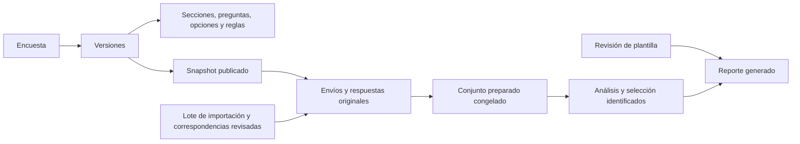

# Evolución a encuestas dinámicas: diagnóstico y plan

Fecha: 2026-10-14. Estado: diseño propuesto; implementación pendiente.

Actualización posterior: el usuario autorizó comenzar cambios locales por incrementos, sin push. El primer editor de borradores y sus límites se registran en [EDITOR_BORRADORES.md](EDITOR_BORRADORES.md). El diseño siguiente conserva su carácter de propuesta para las etapas restantes.

## 1. Alcance autorizado de este paso

El usuario dio luz verde al **paso 1: diagnóstico y diseño**, después de pedir un trabajo por etapas que pudiera comprender y revisar. Este documento es el resultado de ese paso. No introduce tablas, migraciones, dependencias, cambios funcionales, despliegues ni modificaciones de configuración.

La referencia es el adjunto «Evolución del formulario estático hacia un sistema dinámico de encuestas y análisis estadístico». Sus instrucciones de implementación se consideran requisitos propuestos para etapas siguientes, no autorización para ejecutarlas en este paso. Se incorporan las solicitudes posteriores: seleccionar encuesta y versión, separar sus análisis y tener plantillas de reportes editables con revisiones.

La inspección corresponde al código local basado en el commit `2038d04`. No se consultaron respuestas, credenciales, el contenido de `application-local.properties` ni la base de Neon. La disponibilidad actual de Render y los datos de campo no están verificados por esta revisión.

## 2. Qué cambia para quien usa la aplicación

El administrador podrá crear una encuesta en pantalla, organizar sus preguntas, verla antes de publicar y generar un enlace para responderla. No necesitará cambiar Java para cada cuestionario nuevo.

El recorrido previsto es:

1. **Encuestas:** crear, duplicar, editar borradores, publicar, cerrar o archivar.
2. **Respuestas:** elegir encuesta y versión exacta; consultar los envíos correspondientes.
3. **Preparación y análisis:** elegir un conjunto congelado y una configuración analítica compatible.
4. **Reportes:** elegir una plantilla, sus secciones y comentarios; generar un documento reproducible.

Ejemplo: «Titulados / versión 1» conserva las respuestas y análisis obtenidos con esa estructura. Cambiar sus opciones crea «Titulados / versión 2». «Empleadores» sigue siendo otra encuesta. Ver ambas en un selector no autoriza mezclar sus resultados.

## 3. Diagnóstico del repositorio

### Arquitectura y componentes

Se mantiene un monolito modular: Java 21, Spring Boot 4.0.8, Spring MVC, Thymeleaf, Spring Security, Spring JDBC y Flyway. PostgreSQL es la base principal; H2 se limita a desarrollo y pruebas. Maven compila e inicia la aplicación. Apache ECharts 6.0.0 se sirve como recurso local. Apache Commons Statistics Inference 1.3 aporta cálculo estadístico.

No hay una aplicación frontend independiente. No hace falta introducir React, un segundo backend ni otro repositorio para este cambio.

| Responsabilidad actual | Componentes inspeccionados | Reutilización y cambio necesario |
| --- | --- | --- |
| Definición de encuestas | `survey/SurveyCatalog.java`, `SurveyDefinition.java`, `Question.java` | Las preguntas ya son datos estructurados, pero las dos encuestas se construyen en Java. Añadir repositorio de definiciones y editor. |
| Validación | `survey/SurveyValidator.java`, `AnswerState.java` | Reutilizar opciones, obligatoriedad y estados. Extraer reglas específicas de titulados; ampliar tipos y reglas declarativas. |
| Formulario público | `web/SurveyController.java`, `templates/survey.html`, recursos del formulario | Reutilizar Thymeleaf y validación del servidor. Fijar la versión en la apertura y el envío del formulario. |
| Respuestas | `response/SurveyResponseRepository.java` | Conserva valores por pregunta y selección. Admite reintentos, pero depende del catálogo y de la representación actual. Adaptar consultas y persistencia a versiones nuevas. |
| Versiones y captura | `data/InstrumentRegistry.java`, `CaptureStore.java`, `CanonicalJson.java` | Reutilizar huellas y capturas. El registro actual usa un estudio fijo y el catálogo al arrancar; separar registro legado y publicación dinámica. |
| Preparación | `wrangling/WranglingService.java`, `WranglingEngine.java` | Reutilizar revisiones, conjuntos congelados y manifiestos. Diccionario, privacidad, unidades y productos están parcialmente ligados a T/E. |
| Estadística | `statistics/AnalysisService.java`, `AnalysisPlan.java`, `StatisticalEngine.java`, `StatisticalMath.java` | Reutilizar cálculos y persistencia. El protocolo y los cruces B01–B08 necesitan un adaptador conservado y un contrato nuevo para encuestas generales. |
| Dashboard | `visualization/DashboardDataService.java`, `DashboardProjection.java`, `web/DashboardController.java` | Reutilizar integridad, tablas, filtros y gráficos. Secciones, filtros y etiquetas actuales conocen titulados/empleadores. |
| Acceso | `security/SecurityConfig.java`, servicios del administrador | Mantener encuestas públicas, ADMIN para editor/datos/reportes, BCrypt, CSRF y configuración inicial local. |
| Reportes e importación | CSV/JSON de captura, preparación y análisis | Hay exportaciones tabulares, pero no editor de reportes ni importadores CSV/XLSX ni generación integral de informes. |

### Límites concretos encontrados

1. `SurveyCatalog` contiene una lista fija de dos encuestas y una versión definida en código. No hay CRUD administrativo de definiciones.
2. `SurveyController` consulta el catálogo tanto en GET como en POST. Con un catálogo editable, publicar otra versión entre apertura y envío podría cambiar la definición validada si no se fija expresamente la versión.
3. V1 limita `survey_response.survey_slug` mediante CHECK a `titulados` y `empleadores`. Añadir solo un editor no permite recibir una tercera encuesta.
4. `Question` representa condiciones simples de una pregunta anterior. No hay validador general de ciclos, secciones condicionales, grupos AND/OR ni reglas entre valores.
5. `SurveyValidator` tiene reglas de negocio de titulados, números enteros y longitudes fijas. Un tipo no reconocido puede caer en la rama por defecto; las definiciones dinámicas deben usar una lista cerrada de tipos admitidos.
6. `InstrumentRegistry` usa el estudio `umss-mercado-2026-borrador`. Su estado `BORRADOR/APROBADA/RETIRADA` es metodológico; no sustituye el ciclo operativo de publicación.
7. `WranglingEngine` distribuye productos con «si es titulados; en otro caso empleadores». Ese comportamiento debe impedirse para encuestas nuevas antes de permitirles entrar en el pipeline.
8. La interpretación de variables, privacidad y escalas depende parcialmente de códigos conocidos. Un nuevo campo numérico o una valoración no demuestra por sí mismo que sea analizable.
9. `AnalysisPlan` permite una lista cerrada de contrastes. `DashboardProjection` y los filtros conocen las dos encuestas actuales. No se puede anunciar análisis arbitrario por tener preguntas editables.
10. No existe carga persistente de adjuntos. No se admite guardar el único original en el disco efímero de Render.

### Esquema existente que se conserva

Las migraciones V1–V6 definen 13 tablas de aplicación:

| Grupo | Tablas |
| --- | --- |
| Administración | `administrator` |
| Estudio y definición congelada | `survey_study`, `instrument_snapshot` |
| Envíos originales | `survey_response`, `survey_answer`, `survey_question_state`, `response_capture` |
| Preparación y revisiones | `wrangling_run`, `wrangling_member`, `wrangling_correction`, `wrangling_origin_classification`, `wrangling_text_coding` |
| Análisis guardados | `statistical_analysis` |

Hay pruebas Java de captura, versiones, reintentos, estados, persistencia del administrador, preparación, estadística, acceso y despliegue; además hay pruebas JavaScript del dashboard. Se utilizarán para regresión. Las cifras de ejecuciones anteriores constan en los documentos de aceptación; no se volvió a ejecutar la suite para esta revisión documental.

## 4. Reglas de conservación

- Conservar los cuestionarios, códigos internos, correspondencias T01–T41/E00–E22/E09_OTRO y los diez criterios únicos. No sustituir códigos históricos por etiquetas o UUID nuevos.
- Conservar respuestas, capturas, snapshots, revisiones, conjuntos y análisis anteriores sin reescribir sus JSON ni sus huellas.
- No deducir una definición o estado faltante de un histórico mediante el catálogo vigente.
- Mantener separados `CON_VALOR`, `SIN_RESPUESTA` y `NO_APLICA`. `NO_SABE` y `NO_PUEDE_VALORAR` siguen siendo valores nominales sin puntaje.
- Los envíos nuevos empiezan en `NO_DECLARADO`. Importar de Forms no demuestra origen `REAL`, elegibilidad ni independencia; la revisión administrativa sigue siendo necesaria.
- Publicar una encuesta no aprueba institucionalmente estudio o instrumento. El modo `OFICIAL` conserva sus requisitos.
- El envío sigue siendo la unidad de cada fila. Coincidencias de correo, organización o texto no autorizan eliminar participaciones distintas.
- Las matrices ordinarias omiten contactos, organización y texto original; los nuevos campos requieren clasificación de privacidad antes de inclusión analítica.
- Los filtros de recepción conservan días inclusivos en `America/La_Paz`. Las bases, escalas, unidades y versiones deben acompañar resultados y gráficos.
- Las migraciones futuras se agregan a partir de la siguiente versión disponible. No se edita V1 para eliminar su CHECK ni se modifica una migración aplicada.

## 5. Arquitectura propuesta

Se conservan módulos por responsabilidad y se introducen componentes pequeños, dentro del mismo monolito:

| Módulo | Componentes propuestos | Función |
| --- | --- | --- |
| `survey` | `SurveyDefinitionProvider`, repositorio JDBC, servicio de borradores/publicación y validador de definiciones | Consultar una versión concreta, editar borradores, publicar de forma transaccional. |
| `survey` | Adaptador del catálogo legado y registros de tipos/reglas | Mantener los dos cuestionarios actuales y evaluar definiciones nuevas sin ejecutar código suministrado por usuarios. |
| `response` / `data` | Resolución de versión, validación por tipo y captura con esquema versionado | Guardar contra el instrumento abierto y preservar originales. |
| `importing` | Adaptadores CSV/XLSX, servicio de lotes y correspondencias | Preparar, revisar y confirmar importaciones administrativas. |
| `wrangling` | Adaptador UMSS actual y preparador genérico separado | Generar conjuntos usando metadata congelada y reglas explícitas. |
| `statistics` | Protocolo legado y especificaciones analíticas versionadas | Elegir variables y operaciones compatibles sin cambiar análisis históricos. |
| `visualization` | Proyección UMSS conservada y proyección genérica | Mostrar resultados de cada contrato sin reclasificar nuevas encuestas como empleadores. |
| `reporting` | Plantillas, revisiones y generador | Congelar resultados, selección, comentarios y presentación para exportar informes. |
| `web` | Controladores y plantillas de editor, selector, importación y reportes | Mantener el flujo comprensible, con ADMIN y CSRF. |

En la transición, las encuestas generales podrán recolectar y consultar respuestas antes de tener análisis genérico. Su pantalla mostrará «análisis todavía no disponible para esta definición», con motivo; no utilizará el protocolo de empleadores como sustituto.

Los formatos JSON existentes no cambian de significado. Un contrato nuevo tendrá `schema_version` y lector propio; los lectores anteriores permanecen disponibles. Añadir campos a un DTO y recalcular todos los hashes históricos no es una estrategia válida.

## 6. Modelo relacional propuesto

Estos nombres y campos son una propuesta de diseño, no tablas creadas. Se reutiliza la persistencia de respuestas en lugar de duplicar `Submission` y `Answer`.

| Tabla propuesta | Campos principales y relaciones |
| --- | --- |
| `survey` | `id`, `study_id` → `survey_study`, `slug` globalmente único, título administrativo, estado activo/archivado, actor y fechas. Identidad estable de la encuesta. |
| `survey_version` | `id`, `survey_id`, `version_code`, `schema_version`, ciclo operativo, definición canónica/hash al publicar, revisión de edición, actor/fechas. UNIQUE encuesta + versión. Título, descripción y consentimiento forman parte de la definición versionada. |
| `survey_section` | Clave versión + sección, título, descripción y posición única por versión. |
| `survey_question` | Clave versión + pregunta; sección, código estable, texto, tipo de dato, variante de interfaz, obligatoriedad, posición, unidad, escala y privacidad. |
| `survey_question_option` | Clave versión + pregunta + código de opción; etiqueta, orden semántico, categoría nominal sin puntaje y puntaje solo si está expresamente definido. |
| `survey_matrix_item` | Clave versión + pregunta + ítem; identificador estable de cada afirmación de una matriz, texto, orden y metadata. Se añade al implementar matrices. |
| `survey_rule` | Versión, regla, destino pregunta/sección, operador admitido y condición estructurada; referencias a preguntas/opciones de la misma versión. Incluye reglas entre valores. |
| `survey_definition_event` | Operación de creación, edición, publicación, cierre o archivo; revisión/hash, actor, motivo cuando corresponda e instante. |
| `import_batch` | Fuente/plataforma, hash y referencia privada del original, tamaño, hoja/configuración de lectura, versión de adaptador y estado de revisión/confirmación. |
| `import_mapping_version` | Lote/perfil, instrumento externo, versión interna de destino, estado de validación, hash, actor y fechas. Congela una configuración de correspondencias. |
| `external_question_mapping` | Versión de correspondencias, identificador de columna externo con ordinal/hoja y metadata de pregunta, destino interno y revisión de equivalencia. |
| `external_option_mapping` | Correspondencia de pregunta, valor externo exacto, código interno y transformación explícita. |
| `import_row` | Lote, hoja/posición o ID externo, contenido original de la fila, estado, errores y eventual `response_id`. Restricciones únicas evitan reconfirmar la misma fila. |
| `submission_source` | `response_id` único, plataforma de captura (`PLATAFORMA`, `MICROSOFT_FORMS`, `GOOGLE_FORMS` o fuente declarada pendiente), lote/fila y fecha externa si existe con precisión conocida. |
| `analysis_specification` | Encuesta/versión, revisión, variables, operaciones, cruces, familias, filtros admitidos, reglas de privacidad, huella y estado. Nueva configuración; no reemplaza `AnalysisPlan` histórico. |
| `report_template` | Identidad, nombre y alcance por encuesta/versión o plantilla genérica compatible. |
| `report_template_revision` | Plantilla, revisión, secciones, tablas, gráficos, presentación, reglas de compatibilidad, hash, actor/fecha. Una revisión utilizada no se sobrescribe. |
| `report_instance` | Revisión de plantilla, análisis/conjunto, selección congelada, resultados y huellas, comentarios, instante/actor y referencia del artefacto si se conserva. Un reporte generado es inmutable. |

Las definiciones se editan en filas normalizadas. Al publicar se produce una única representación canónica verificada contra ellas; después las filas estructurales y ese documento quedan inmutables. No hay dos fuentes editables para una misma versión publicada.

La versión dinámica se vinculará a `instrument_snapshot` mediante la pareja existente encuesta/versión, con estudio y hash verificados. Para instrumentos nuevos se introduce el contrato de snapshot correspondiente; los snapshots legados mantienen su formato. Publicación técnica y aprobación metodológica siguen en campos/ciclos distintos.

`survey_response` podrá recibir una referencia nullable a la nueva versión, con consistencia respecto de `survey_slug`/`instrument_version`, sin forzar metadata inexistente en históricos. `survey_answer` sigue almacenando valores originales; las opciones múltiples se mantienen como filas. Tipos compuestos incorporarán vínculos auxiliares versionados cuando sean necesarios, por ejemplo ítem de matriz o referencia de adjunto.

Las claves foráneas de secciones, preguntas, opciones y reglas deben incluir la versión para impedir referencias accidentales a otra encuesta. La persistencia de envíos nuevos exige la versión exacta y todas las escrituras de captura en una transacción.

## 7. Versiones, publicación y edición

Se propone el ciclo operativo `BORRADOR → PUBLICADA → CERRADA`, con archivo administrativo de la encuesta. El estado metodológico `BORRADOR/APROBADA/RETIRADA` permanece separado.

| Operación | Resultado propuesto |
| --- | --- |
| Editar borrador | Actualizar solo el borrador, con control de revisión para evitar perder cambios de otra pestaña. |
| Publicar | Validar tipos, condiciones, consentimiento y metadata; congelar definición y registrar evento, todo en una transacción. |
| Editar versión publicada | Crear un borrador sucesor. No hacer UPDATE de su estructura original. |
| Duplicar encuesta | Nueva identidad y borrador; copiar estructura, nunca respuestas ni aprobación institucional. |
| Cerrar/archivar | Detener nuevos envíos según la política registrada; conservar consulta de originales y resultados. |
| Cambiar tipo, unidad o significado de pregunta | Nueva versión y nueva identidad de variable cuando la semántica cambie. No asumir equivalencia por texto o posición. |

El enlace de respuesta debe identificar una versión concreta. El enlace corto de una encuesta puede dirigir a la publicada elegida, pero al abrir el formulario se fija su versión en la acción y en el token de sesión. El servidor no acepta la versión oculta sin verificarla.

Propuesta para formularios abiertos: publicar una sucesora no altera la versión ya abierta; esta puede recibir mientras siga abierta. Si se cierra, el servidor explica el cierre sin trasladar las respuestas a otra versión. Un reintento idéntico ya aceptado devuelve su referencia aunque luego se cierre; otro contenido con el mismo token sigue dando conflicto.

No se eliminan versiones con envíos ni se cambia una encuesta de estudio para reinterpretar su historia. Publicar, cerrar o aprobar son acciones diferentes.

## 8. Tipos de pregunta y análisis permitido

La variante visual se separa del tipo almacenado y de la escala estadística. El editor no admite código JavaScript, SQL, plantillas ejecutables ni expresiones arbitrarias.

| Tipo pedido | Representación y validación propuesta | Interpretación inicial |
| --- | --- | --- |
| Selección única / desplegable | Código de opción admitido; un valor | Nominal u ordinal según metadata, no según el control HTML. |
| Selección múltiple | Conjunto de códigos únicos; mínimos/máximos | Base de participantes y de menciones separadas. |
| Texto corto / largo | Texto con límites; formatos permitidos por lista cerrada | Original restringido; temas solo tras codificación revisada. |
| Número | Entero o decimal explícito, rango y unidad; rechazar valores no finitos | Descriptivos compatibles con su escala; no inferir que un código numérico es magnitud. |
| Fecha | Fecha ISO y límites; precisión/semántica identificadas | Distribución temporal; duraciones únicamente con derivación definida. |
| Valoración | Códigos ordenados con presentación numérica/estrellas/símbolos | Ordinal por defecto; no media automática de estrellas. |
| Likert | Ítems estables y opciones de escala por ítem; estados separados | Distribuciones por ítem, sin índice total implícito. |
| Clasificación | Lista ordenada de opciones distintas; reglas para ranking parcial | Posiciones por opción y bases conocidas; ausente no equivale a último lugar. |
| NPS | Entero 0–10 con categorías documentadas | Fórmula NPS configurada y base de respuestas válidas explícita; no aplicarla a cualquier escala de valoración. |
| Archivo | Referencia a almacenamiento privado, tamaño y tipo verificados | Metadata técnica; contenido excluido del análisis ordinario. |

La primera entrega soporta los tipos ya utilizados: selección única/múltiple, desplegable, texto y entero, manteniendo correo/teléfono/URL. Decimal, fecha, valoración, Likert agrupada, clasificación y NPS siguen en incrementos definidos. Adjuntos requieren almacenamiento y política propios antes de habilitar publicación de ese tipo.

Las condiciones deben comprobar referencias existentes, orden de evaluación, ciclos y coherencia entre obligatoriedad/aplicabilidad. Primero se admite la condición actual sobre una pregunta anterior; AND/OR y secciones se amplían con un lenguaje limitado. En el servidor, las preguntas omitidas no guardan valores enviados indebidamente y conservan `NO_APLICA`.

Se extraen las reglas específicas de titulados a un adaptador legado o reglas declarativas equivalentes: no se pierden comprobaciones de desempleo, experiencia, selección de materias o las competencias aprobadas.

## 9. Migración incremental sin pérdida de datos

1. Añadir las nuevas tablas mediante Flyway, sin eliminar ni reemplazar tablas actuales. Comprobar primero la siguiente versión libre de migración y las restricciones efectivas en H2/PostgreSQL.
2. Registrar identidades de las dos encuestas y vincular únicamente definiciones existentes cuya versión y hash puedan verificarse. El catálogo del código sirve para la definición vigente; no reconstruye versiones antiguas desconocidas.
3. Mantener el adaptador legado y sus rutas mientras se crea el editor de borradores. El registro al arrancar no sobrescribe definiciones gestionadas en base ni publica borradores.
4. Agregar la resolución de versión explícita y la captura compatible. Cambiar el CHECK de `survey_response.survey_slug` en una migración nueva antes de permitir una tercera encuesta; localizar el nombre real de la restricción en cada motor, no asumir uno autogenerado.
5. Permitir nuevos envíos con las mismas garantías transaccionales, estados y reintentos. Conservar `/encuestas/titulados` y `/encuestas/empleadores` como enlaces compatibles que resuelven a una versión definida.
6. Añadir filtros de consulta por encuesta/versión. El análisis legado solo recibe entradas compatibles; una encuesta sin adaptador no entra en el producto de empleadores.
7. Adaptar preparación, análisis y visualización en etapas separadas. Guardar formato/protocolo de cada salida; no recalcular bundles anteriores como parte de la actualización.
8. Ensayar migración con una base de prueba anterior y datos sintéticos. Antes de desplegar migraciones reales, preparar copia privada y procedimiento de recuperación; revertir el JAR no revierte el esquema automáticamente.

En este paso no se conecta ni migra Neon. El archivo local permanece privado; el inicio continúa manual con Maven. Cada incremento futuro indicará archivos, migración, efecto en datos, comando de ejecución y evidencia, sin scripts que cambien credenciales o configuración silenciosamente.

## 10. Compatibilidad e importación de Forms

Los enlaces de Microsoft Forms y Google Forms del adjunto se intentaron consultar el 2026-10-14, pero la herramienta de navegación no pudo acceder a su contenido. **No se verificó la estructura publicada ni su equivalencia con los anexos.** No se completaron ni enviaron formularios.

La primera integración será por archivos exportados bajo autorización, no por extraer respuestas desde enlaces públicos ni por inventar una API de acceso. Los adaptadores de Microsoft/Google leen archivos y metadata configurados; la selección del adaptador no certifica que el archivo sea oficial.

Flujo: **cargar → inspeccionar → proponer correspondencias → revisar → vista previa → confirmar → conservar lote y originales**.

- Identificar columnas por hoja, posición y encabezado original; los encabezados repetidos no se colapsan en un mapa por texto.
- Si la exportación no proporciona ID estable de pregunta, registrar esa ausencia y la estructura externa capturada; no inventarlo ni equiparar columnas solo por nombres iguales.
- Validar tipo, escala, unidad, opciones, obligatoriedad y condiciones. Las correspondencias ambiguas quedan pendientes y no ingresan al conjunto analítico.
- Conservar el archivo original y las filas sin alterar en almacenamiento privado durable. Una referencia a un archivo temporal del contenedor no es conservación suficiente.
- Separar **plataforma de captura**, **origen REAL/SINTETICO/NO_DECLARADO** y **aprobación institucional**. Son dimensiones diferentes.
- Conservar fecha externa y su precisión cuando exista, separada de la recepción/importación interna. Un blanco importado no permite inferir `NO_APLICA` si faltan reglas externas verificables.
- Conservar el consentimiento informado disponible; un archivo sin evidencia de consentimiento no se inserta inventando `consent=TRUE`. Se registra en preparación/importación y queda pendiente de política de incorporación, con captura de procedencia distinta de una participación web.
- Idempotencia: identificar original por hash, revisión de correspondencias y filas por lote/hoja/posición o ID externo verificable. Reconfirmar devuelve el resultado previo; cambiar correspondencias crea revisión y exige resolver el destino de filas ya confirmadas, sin duplicarlas silenciosamente.
- Detectar posibles solapamientos entre archivos y presentar candidatos con motivo. No eliminar personas/envíos distintos por correo, organización o valores coincidentes.
- Limitar tamaño, filas, columnas y tiempo de lectura; no ejecutar fórmulas, macros ni vínculos externos. No adivinar separadores de selecciones múltiples cuando sean ambiguos.

CSV se implementa primero. XLSX requiere una dependencia justificada; Apache POI XSSF es una candidata para lectura del formato, evaluando memoria y límites antes de elegir versión. [Documentación oficial de Apache POI](https://poi.apache.org/components/spreadsheet/).

La aceptación requiere exportaciones reales autorizadas o ejemplos representativos validados. No se afirma compatibilidad completa con ambos proveedores basándose únicamente en fixtures inventadas.

## 11. Análisis separados y reportes modificables

La selección visible es **estudio → encuesta → versión → conjunto → configuración analítica → análisis → plantilla/revisión de reporte**. Una selección distinta no modifica una ejecución existente.

Cada versión declara variables, unidades, categorías ordinales, categorías nominales sin puntaje y privacidad. Las operaciones permitidas dependen de esta metadata. Descriptivos genéricos se incorporan antes que cruces configurables; no se abre chi-cuadrado a cualquier par de campos ni se presenta asociación como causalidad.

Los contrastes conservan base pareada, esperadas, supuestos, documentación de independencia, familias, corrección de multiplicidad y efecto cuando corresponde. No ejecutar una prueba mantiene p/decisión ausentes, sin anunciar «sin asociación». El protocolo UMSS actual sigue disponible para sus instrumentos compatibles.

Una comparación entre versiones necesita correspondencias analíticas revisadas con transformación, pérdida de información, unidades y alcance documentados. La vista por defecto separa versiones. Cambiar categorías o unidades no permite combinar filas automáticamente.

| Elemento del reporte | Qué puede editarse |
| --- | --- |
| Plantilla en borrador | Título, orden de secciones, tablas/gráficos compatibles, estilo y filtros permitidos. |
| Revisión de plantilla usada | Se conserva; editar crea otra revisión. |
| Comentarios/interpretación | Texto administrativo separado de resultados calculados, con actor/revisión. |
| Cifras, bases y pruebas | No se editan a mano. Cambiar selección o registrar una corrección genera nueva preparación/análisis según corresponda. |
| Reporte generado | Se conserva; modificarlo genera otra instancia o revisión, sin alterar el archivo/resultados previos. |

Una plantilla puede tener alcance específico por encuesta/versión o ser genérica con comprobaciones de compatibilidad. Referir una pregunta inexistente produce un diagnóstico antes de generar, sin sustituirla por posición o etiqueta.

Ejemplo: la misma versión de Titulados puede tener una plantilla de empleabilidad y otra de formación continua. Empleadores usa sus variables y bases propias. Cambiar una plantilla no cambia las respuestas ni el análisis.

Cada reporte conserva análisis fuente, conjunto, filtros, selección y resultado exactos, hashes, revisión de plantilla, comentarios, generador/formato y denominadores. Si usa filtros del dashboard que hoy no se persisten como análisis independiente, debe congelar también esa selección y resultado verificados; guardar únicamente el ID del análisis base sería insuficiente.

Primero se implementa reporte HTML protegido y exportación tabular; Excel y PDF/gráficos exportados requieren pruebas y decisiones de dependencias/renderizado. No se promete reproducibilidad byte a byte de PDF: se distingue contenido lógico de hashes del archivo generado. Los textos se escapan y los CSV/Excel conservan protección frente a fórmulas.

## 12. Plan por etapas y aceptación

Las etapas siguientes están propuestas. La autorización de este turno cubre únicamente el diagnóstico documental de la etapa 1.

| Etapa | Alcance | Entrega comprobable | Condición para pasar a la siguiente |
| --- | --- | --- | --- |
| 1. Diagnóstico | Arquitectura, conservación, modelo y plan | Este documento | Revisión del diseño y autorización de implementación. |
| 2. Editor de borradores | Tablas de definición, repositorio, CRUD, secciones y tipos actuales | Crear/duplicar/editar sin cambiar Java | Persistencia tras reinicio, control de revisión, ADMIN/CSRF, catálogo legado intacto. |
| 3. Publicación | Versiones inmutables, preview, enlaces, cierre/archivo y eventos | Publicar V1, preparar V2 y seguir viendo V1 | Hash estable, publicación transaccional, aprobación separada y rechazo de edición publicada. |
| 4. Recolección | Resolución de versión, respuestas, reglas y ampliación gradual de tipos | Nueva encuesta publicada → envío → consulta por versión | GET/POST fijados a una versión, validación del servidor, estados, reintentos y rollback de escritura. |
| 5. Selector y preparación | Selección de encuesta/versión; preparador genérico, privacidad/diccionario | Preparar solo envíos seleccionados y congelar sus reglas | No reclasificar como empleadores ni reconstruir metadata histórica; originales y hashes intactos. |
| 6. Análisis configurable | Descriptivos, luego cruces y proyección genérica | Resultados apropiados para variables configuradas | Bases explícitas, pruebas de supuestos, separación de versiones y contrato legado conservado. |
| 7. Reportes | Plantillas/revisiones, comentarios, generación HTML y salidas progresivas | Dos reportes distintos del mismo análisis sin alterar cifras | Reproducción lógica, referencias exactas, autorización y diagnósticos de incompatibilidad. |
| 8a. Importación CSV | Lectura, correspondencias, preview, lotes e idempotencia | Importación validada con originales conservados | Repetición sin nuevos envíos indebidos, errores útiles y estado de fuente/consentimiento conocidos. |
| 8b. XLSX y exportaciones | Adaptadores Excel y formatos adicionales acordados | Ejemplo externo validado para cada proveedor | Memoria/tamaño controlados y datos sin fórmulas ejecutadas; formatos verificados. |
| Separada. Adjuntos | Almacenamiento privado durable y reglas de acceso/retención | Carga/descarga autorizada persistente tras reinicio | Infraestructura y límites definidos; sin habilitar tipos ficticios. |

El **primer circuito funcional completo** se logra al cerrar las etapas 2–4: crear encuesta → publicar versión → responder → consultar. Análisis configurable, reportes e importación no se anunciarán terminados en ese momento.

La simulación con modelo definido y el documento final de Análisis de Mercado siguen siendo entregables del proyecto. El cambio a encuestas dinámicas no los sustituye ni los declara resueltos.

## 13. Verificación prevista para implementación

Pruebas significativas por incremento, además de la regresión existente:

- Migrar una base anterior sintética: conservar filas, snapshots, capturas, revisiones y hashes; aplicar migración una vez y arrancar nuevamente.
- Publicar y editar V2 mientras un formulario V1 está abierto: aceptar con V1 cuando corresponda, nunca validar con V2 por accidente.
- Mantener una versión publicada intacta al editar/duplicar/archivar y comprobar que cerrar bloquea nuevos envíos sin borrar consultas históricas.
- Intentar operaciones administrativas sin ADMIN o sin CSRF; verificar escapes de texto en editor, preview, formulario, comentarios y reportes.
- Validar un ejemplo y un caso inválido significativo por tipo; rechazar tipos desconocidos, opciones ajenas, ciclos y reglas cruzadas entre versiones.
- Reintentar el mismo envío/importación y generar conflicto con contenido distinto sin sobrescribir el original.
- Separar encuestas/versiones y comprobar que un conjunto general no entra al adaptador UMSS incorrecto.
- Comparar resultados con vectores conocidos; conservar estados, denominadores, cero/ausencia y categorías nominales sin puntaje.
- Generar una nueva revisión de reporte y comprobar que la anterior conserva selección, comentarios y cifras.
- Importar ejemplos externos validados con columnas repetidas, cambios de orden, blancos, celdas inválidas, selecciones ambiguas y fechas de precisión limitada.
- Comprobar persistencia PostgreSQL, límites de memoria y flujo en navegador antes de publicar cada incremento en Render.

No se ejecutan estas pruebas todavía porque no hay implementación nueva en este paso. No se iniciará la aplicación contra Neon para comprobar un documento.

## 14. Riesgos y decisiones que permanecen abiertas

| Punto | Tratamiento propuesto / decisión pendiente |
| --- | --- |
| Cambio de definición con respuestas previas | Publicación inmutable, sucesor y versión fijada por envío. |
| Confundir publicación con oficialidad | Ciclos separados; mantener requisitos `OFICIAL`. |
| Interpretar otra encuesta como empleadores | Adaptador explícito; bloquear pipeline no compatible hasta implementar preparador general. |
| Históricos incompletos | Conservar limitación; no completar con catálogo actual. |
| Equivalencia Microsoft/Google/anexos | Revisar instrumentos y exportaciones; D19 no queda resuelta automáticamente. |
| Importaciones sin consentimiento o sin fecha verificable | Conservar staging y procedencia; resolver política antes de incorporación web/analítica. |
| Idioma, CSV y selecciones múltiples | Configuración de lectura y correspondencias revisadas, no separación adivinada. |
| Adjuntos y archivos de origen | Decidir almacenamiento privado durable, cuotas, tamaños y retención; disco temporal no basta. |
| Excel/PDF en memoria limitada | Evaluar dependencia y lectura/generación limitada antes de habilitar formatos. |
| Alcance del editor de reportes | Inicialmente configuración de secciones y estilos permitidos; no diseñador libre con código ejecutable. |
| Fecha de entrega | No comprometida todavía; estimar por incremento tras revisar alcance y ejemplos externos. |
| Decisiones institucionales | Mantener pendientes elegibilidad, participaciones, unidad empleadora, libro de códigos, cohortes, muestreo y plan institucional de contrastes. |

Para empezar la etapa 2 se propone el alcance pequeño de tipos ya existentes y un editor administrativo de borradores. Fechas, ranking, NPS, adjuntos, importación y reportes no se incorporan silenciosamente a ese incremento.

## 15. Fuentes y límites de esta revisión

Se consultaron instrucciones del proyecto, código y migraciones, junto con las decisiones y especificaciones de fases 1–5. Los registros de aceptación describen pruebas anteriores, no pruebas ejecutadas en este turno:

- [Decisiones](DECISIONES.md), [instrumento](INSTRUMENTO.md) y [fase 1](01_ESTABLECER_REPOSITORIO.md).
- [Requisitos de cuestionarios](02_REQUISITOS_CUESTIONARIOS.md) y [aceptación](ACEPTACION_CUESTIONARIOS.md).
- [Referencia de datos](03_DATOS_Y_DATA_WRANGLING.md), [preparación implementada](DATOS_Y_WRANGLING.md) y [aceptación](ACEPTACION_DATOS.md).
- [Referencia estadística](04_ESTADISTICA_UNIVARIADA_BIVARIADA_CHI_CUADRADO.md), [contrato](ESTADISTICA.md) y [aceptación](ACEPTACION_ESTADISTICA.md).
- [Referencia visual](05_VISUALIZACION_COMPUTACIONAL.md), [contrato](VISUALIZACION.md) y [aceptación](ACEPTACION_VISUALIZACION.md).

El adjunto original permanece fuera del repositorio. No se copiaron datos privados, archivos de exportación ni credenciales. La revisión no acredita un formulario institucional definitivo, acceso a resultados de Forms o una compatibilidad externa ya implementada.
