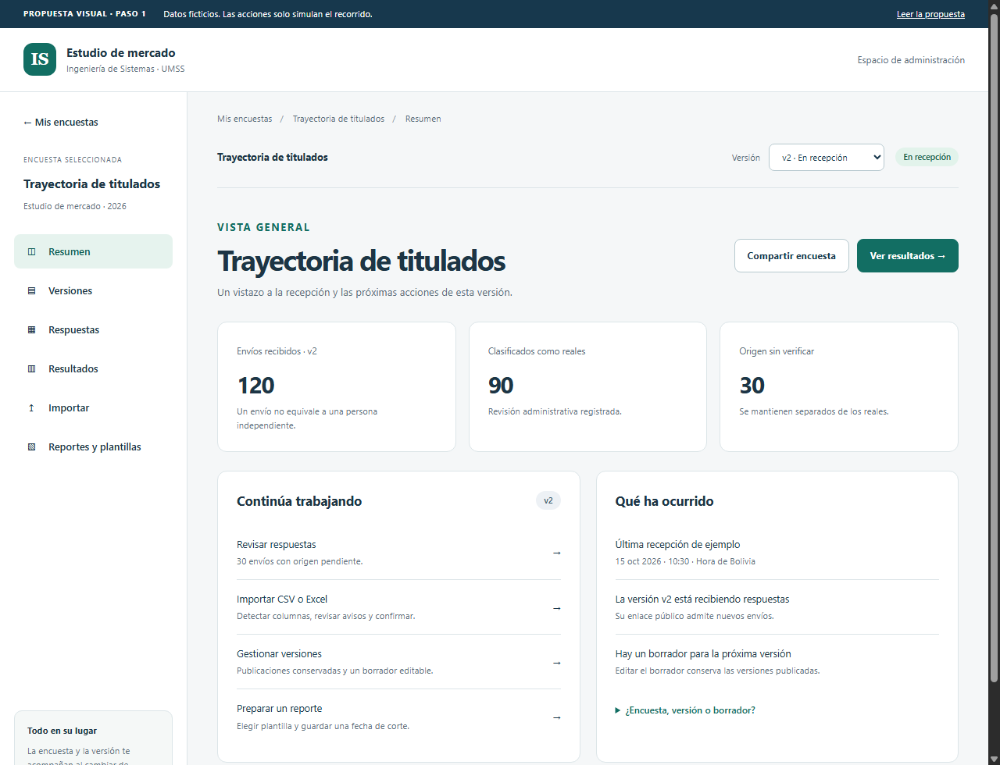

# Rediseño del espacio de encuestas · Paso 1

El paso 2 ya cuenta con un espacio real integrado en el monolito. Consulta [ESPACIO_ENCUESTAS.md](ESPACIO_ENCUESTAS.md). La maqueta de este documento conserva el alcance visual del paso 1.

El paso 3 también está implementado: [ASISTENTE_IMPORTACION.md](ASISTENTE_IMPORTACION.md).

El paso 4 incorpora resultados actualizados para versiones del editor: [RESULTADOS_ACTUALIZADOS.md](RESULTADOS_ACTUALIZADOS.md).

Fecha: 15 de octubre de 2026. El usuario autorizó el paso 1: diseñar el recorrido y las pantallas antes de implementar la reorganización funcional. Es una propuesta revisable; no declara terminados los pasos siguientes ni cambios en las aprobaciones institucionales.

## Prototipo navegable

Abrir [espacio-encuesta.html](prototipos/espacio-encuesta.html) directamente en un navegador. No necesita Maven, conexión, instalación ni credenciales. Sus archivos CSS y JavaScript son locales. Todo el contenido es ficticio; no consulta endpoints, no guarda datos, no importa archivos y no genera exportaciones. Está fuera de los recursos públicos del monolito.

Recorrido sugerido:

1. En **Mis encuestas**, abrir Trayectoria de titulados.
2. En **Versiones**, abrir v1 y consultar Resultados. Cambiar a v2 desde el selector y comprobar que el contexto cambia sin abandonar la sección.
3. En **Resultados**, consultar gráfico, tabla equivalente y explicación del chi-cuadrado suspendido. Cambiar origen para ver el estado pendiente sin mezclarlo con los reales.
4. En **Importar**, usar el archivo de ejemplo, resolver la correspondencia «A?» y continuar. Marcar la confirmación para habilitar la simulación. Repetir con v1 para ver el aviso de versión cerrada.
5. En **Reportes y plantillas**, cambiar las secciones, previsualizar y consultar los formatos previstos.
6. Volver a Mis encuestas y abrir Demanda de empleadores. Las cifras y las categorías de ejemplo son diferentes.

## Organización propuesta

```text
Mis encuestas
└── Encuesta elegida
    ├── Resumen: recepción, estado y próximas acciones
    ├── Versiones: publicaciones, borrador y variantes
    ├── Respuestas: consulta, procedencia y revisión
    ├── Resultados: descriptivos, gráficos y cruces explicados
    ├── Importar: archivo → revisión → confirmación
    └── Reportes y plantillas: presentación, corte y exportación
```

La encuesta es el contexto principal. Un selector persistente identifica una versión publicada o cerrada. Respuestas, importación, resultados y reporte usan esa versión; no hay selección silenciosa de «todas las versiones». Versiones agrupa las publicaciones y el borrador editable. Un borrador no ofrece resultados ni recepción. Volver al listado permite cambiar de encuesta.

| Concepto | Explicación en la interfaz | Acción principal |
| --- | --- | --- |
| Encuesta | Agrupa un instrumento y su trabajo | Abrir espacio |
| Versión publicada | Conserva definición y respuestas propias | Ver respuestas y resultados |
| Versión activa | Destino del enlace principal | Compartir enlace principal |
| Versión cerrada | Conserva datos; no recibe envíos nuevos | Consultar resultados |
| Borrador | Cambios para una publicación futura | Editar / previsualizar |
| Variante | Otra encuesta con propósito o público diferente | Duplicar estructura, sin respuestas |
| Plantilla de cuestionario | Estructura para crear encuestas | Usar al crear |
| Plantilla de reporte | Presentación de resultados | Elegir o editar secciones |

Publicar y activar siguen siendo acciones distintas. Editar una versión publicada inicia o retoma un borrador; no modifica el instrumento que produjo respuestas existentes. Las variantes conservan referencia de origen y no heredan aprobaciones.

## Contrato de cada pantalla

| Pantalla | Qué debe responder | Acciones y apoyo visual |
| --- | --- | --- |
| Mis encuestas | ¿Con cuál voy a trabajar? | Tarjetas con título, estado, versiones y Abrir; crear desde cero o plantilla |
| Resumen | ¿Qué está pasando y qué sigue? | Envíos por origen, estado de recepción, actividad y accesos directos |
| Versiones | ¿Qué puedo editar y qué está publicado? | Estados escritos, historial, abrir versión, retomar borrador y crear variante |
| Respuestas | ¿Qué envíos tengo? | Filtros, referencias, procedencia, revisión e importación contextual |
| Resultados | ¿Qué dicen los datos seleccionados? | Bases visibles, gráficos con tablas, filtros y explicación junto al resultado |
| Importar | ¿Qué detectó y qué debo resolver? | Tres pasos, correspondencias propuestas, discrepancias por fila y confirmación |
| Reportes | ¿Qué voy a compartir y con qué corte? | Plantilla, secciones, vista previa y formatos |

Navegación persistente, migas de ubicación, etiquetas de estado con texto y un botón principal por tarea. Ayudas desplegables explican términos sin bloquear el recorrido. En móvil, el menú se transforma en una fila desplazable y las tarjetas se apilan. Las tablas conservan desplazamiento horizontal propio.

## Resultados actualizados y guardados

La vista exploratoria futura actualizará resultados desde Java manteniendo encuesta, versión, origen y filtros. No se propone calcular chi-cuadrado en JavaScript ni leer respuestas actuales para rellenar conjuntos históricos. Una selección actualizada debe crear o reutilizar una preparación verificada e identificable con su corte; si falla la actualización, debe mantenerse visible el último corte y avisar que está desactualizado. Evitar nuevas preparaciones idénticas en cada consulta es un detalle de implementación del paso 4.

«Actualizado» indicará hora real del resultado, zona America/La_Paz y alcance. Una actualización no saltará de versión, mezclará estratos ni convertirá orígenes sin verificar en reales. Los datos sintéticos tendrán indicación persistente. Una versión sin respuestas muestra estado vacío, no gráficos en cero.

Los reportes conservan fuente, selección, protocolo, huellas y corte. Llegar nuevos envíos no cambia el documento guardado. La exportación debe corresponder a la selección que se previsualizó, incluso si llegan datos durante la generación.

El apoyo estadístico distinguirá descripción e inferencia, mostrará bases y explicará pruebas no aplicables. «No se pudo ejecutar» no significa «no hay asociación». No se ofrece «proyección» como pronóstico: las previsiones o simulaciones necesitan un modelo definido en otra etapa. Los radares y diez criterios de empleadores mantienen el contrato metodológico existente, sin índices nuevos.

## Simplificar importación y confirmaciones

El usuario pidió automatizar lo posible, informar discrepancias y sustituir justificaciones rutinarias por confirmaciones simples. Esta dirección queda incorporada al diseño; el backend actual no cambia en el paso 1.

| Situación | Experiencia propuesta |
| --- | --- |
| Encuesta y versión elegidas | Se heredan al abrir el asistente |
| Encabezado/código inequívoco | Proponer correspondencia automática y mostrarla |
| Hoja, separador o formato ambiguo | Pedir elegir entre opciones concretas |
| Código incompatible | Mostrar fila, valor, pregunta y resolución posible |
| Coincidencias entre lotes | Mostrar candidatos y permitir revisión explícita, sin deduplicar personas por nombre/correo |
| Revisión rutinaria de una propuesta | Checkbox sin redacción obligatoria; registrar actor, fecha y alcance |
| Consentimiento en la fuente | Mostrar campo/documento existente y qué aceptación contiene |
| Consentimiento ausente | Informar el faltante y conservar el lote; una casilla no inventa consentimiento de participantes |
| Documento que exige evidencia escrita | Mostrar requisito y motivo en ese punto; permitir referencia reutilizable con ámbito y versión válidos |
| Cambia el archivo, versión o correspondencia | Revalidar y pedir confirmar el contenido actualizado |
| Clasificación o corrección de datos | Registrar la revisión exigida y conservar originales; no confundirla con aceptar términos de uso |

Las rutinas automáticas no deben aprobarse a sí mismas. La evidencia metodológica de independencia, aprobaciones oficiales y conservación de originales siguen el contrato vigente. No se pide al usuario un motivo en texto para cada clic. Los textos obligatorios actuales se revisarán por requisito concreto en el paso 3; no se eliminarán requisitos por una suposición del diseño.

## Acciones simuladas y trabajo restante

El prototipo permite navegación, selección de versión, búsqueda en un extracto, cambio de origen, resolución de una discrepancia y confirmación con casilla. Los diálogos describen edición, variantes, enlace público, revisión, cruces y formatos. Las barras muestran fixtures declaradas; no son análisis ni sincronización funcional. La vista previa del reporte solo describe la selección y no genera PDF.

| Paso | Entrega posterior | Señal de aceptación |
| --- | --- | --- |
| 2 | Espacio real por encuesta y versiones | Navegar sin volver a elegir encuesta; autorización y datos preservados |
| 3 | Asistente real de importación | Propuestas automáticas revisables, avisos accionables y confirmaciones acotadas |
| 4 | Resultados actualizados desde backend | Mismo contexto, filtros, origen y corte; manejo de fallos y estados vacíos |
| 5 | Explicaciones y apoyo visual completos | Gráficos/tablas equivalentes, aplicabilidad y comprensión verificadas |
| 6 | Reportes y exportaciones reales | PDF/imágenes/datos coinciden con el resultado previsualizado |
| 7 | Prueba del recorrido completo | Crear, publicar, recibir/importar, analizar y exportar sin perder contexto |

No hay cambios de esquema, controladores, autenticación, migraciones ni datos en este paso. No se realiza commit, push ni despliegue. Las decisiones visuales quedan abiertas a revisión antes del paso 2.

## Verificación del paso 1

Chrome comprobó las siete pantallas a 360, 768 y 1280 píxeles (21 vistas), sin desbordamiento de página ni excepciones JavaScript. Se verificaron cambio de encuesta/versión, separación por origen, búsqueda en el extracto, discrepancia de importación y habilitación mediante checkbox. El archivo se abrió directamente con `file://`, sin servidor ni recursos externos. `node --check` y `git diff --check` finalizaron correctamente. No se ejecutó la suite Java porque este paso no modifica el monolito. No constituye una auditoría completa de accesibilidad.



## Avance del paso 5

Implementado el apoyo visual y las explicaciones de resultados del espacio de encuestas: [ayudas, alcance y verificación](AYUDAS_RESULTADOS.md). Incluye lectura de barras y medidas, bases, mapas de calor y requisitos de chi-cuadrado. Las exportaciones del paso 6 siguen pendientes.

## Avance del paso 6

Implementadas las [exportaciones de reportes](EXPORTACIONES_REPORTES.md): PDF mediante impresión del navegador, gráficos PNG/SVG con contexto y datos CSV/Excel/JSON del corte guardado. El paso 7 se verifica en [ACEPTACION_REDISENO.md](ACEPTACION_REDISENO.md).

## Cierre del paso 7

Recorrido técnico del editor comprobado desde creación/publicación hasta recepción/importación, corte guardado y exportación, conservando v1 al activar v2. Pasaron 522 pruebas Java en H2 y 522 en la ejecución con PostgreSQL temporal, 11 JavaScript y 51 vistas en Chrome. Consulta [la matriz de evidencia y límites](ACEPTACION_REDISENO.md). No sustituye la aceptación con usuarios reales ni la aprobación institucional.
